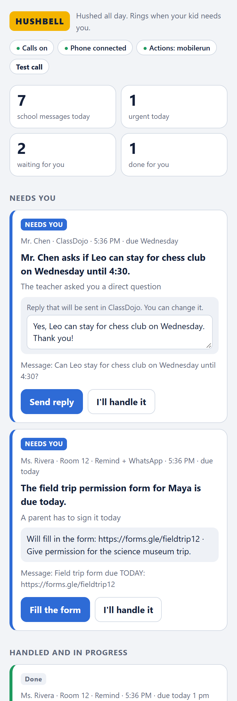

# Hushbell

**Hushed all day. Rings when your kid needs you.**

Parents get dozens of school messages a day, spread across Remind, ClassDojo, WhatsApp parent
groups and email. Most of it can wait. Hidden in the pile is sometimes the one that can't:
*"Maya has a fever, please pick her up by 1 pm."* With Do Not Disturb on, that one gets missed too.

Hushbell is an open-source agent that watches the school apps on your own phone while it's on
Do Not Disturb:

- **Noise waits.** Bake sales, newsletters and photos go into one evening digest.
- **Things that need a yes become one card.** "Field trip form due today, trip next Friday" →
  one tap and Hushbell fills in the form *and* puts the trip on your calendar. You can edit a
  reply or untick any step first.
- **Emergencies ring through.** Hushbell is the only caller your phone lets through Do Not
  Disturb. It tells you what happened, you press **1**, and it handles the whole situation on
  your phone: replies to the teacher, sets a "time to leave" alarm, texts your co-parent, and
  opens directions to school.
- **The school can call Hushbell.** It answers, asks who's calling and why, and if it's urgent it
  rings you through Do Not Disturb. Press 1 and you're connected to the caller, while Hushbell sets
  your alarm, texts your co-parent and opens directions.
- **Coming up.** Every date in your school messages (trips, picture day, deadlines) in one list,
  with "Add to calendar".
- **Ask Hushbell.** "What do I need to do this week?" Type it on the page, or call Hushbell from
  your own phone and ask out loud.

You never open a school app, and nothing is sent, signed or paid without your OK.

<p align="center">
  
  <br><em>The Hushbell page on a phone, with example messages.</em>
</p>

### What Hushbell does for each kind of message

| Message | Hushbell's plan, run after your OK |
|---|---|
| "Maya has a fever, please pick her up by 1 pm" | Calls you through DND → reply to the teacher, alarm at 12:30 to leave, text your co-parent, directions to school |
| The school nurse **calls** Hushbell's number | Hushbell answers and takes the message → calls you through DND → press 1 to be connected to the nurse, plus the alarm, text and directions |
| "Field trip next Friday, permission form due today" + link | Fill in and submit the form, add the trip to your calendar |
| "Can Leo stay for chess club Wednesday until 4:30?" | Reply to the teacher (you can edit it), add chess club to your calendar |
| "Picture day is next Thursday" | Saved for tonight's digest, with an "Add to calendar" button |
| "Bake sale Friday, bring cookies" | Saved, or a card if it's tomorrow, with the date on your calendar |

## How it works

A 2-minute animated walkthrough is in [`docs/explainer.html`](docs/explainer.html) (download it and open it in a browser).

```
 school apps on your phone            Hushbell on your laptop                       you
 ─────────────────────────            ───────────────────────                       ───
 Remind, ClassDojo,        USB   ① Read new notifications (adb)
 WhatsApp group, Gmail  ───────► ② Tidy: which child, merge the same news from two apps
                                 ③ Safety rules first: fever, hurt, pick up, lockdown…
                                 ④ Claude sorts the rest: urgent · needs you · later
                                        │
                     ┌──────────────────┼───────────────────────┐
                  URGENT            NEEDS YOU                  LATER
             Twilio calls you    a card on the Hushbell     the 6 pm digest
             through DND ───────►page (any phone browser)
                     └─────► ⑤ wait for your OK (LangGraph interrupt) ◄──┘
                                        │ press 1 / tap Approve
                             ⑥ do the plan on your phone: reply in the app (Mobilerun),
                               alarm, calendar, text, directions (Android shortcuts)
```

- **Reading** uses `adb shell dumpsys notification`, so nothing is installed on the phone for it,
  and it works with apps that have no API or integration.
- **Safety rules** are plain patterns that run before any AI, so a model mistake can't hide a sick
  child. They skip look-alikes such as "emergency contact form" and "lockdown drill".
- **Sorting** uses Claude (`claude-opus-5-5` by default, low effort, structured output). If Claude
  is unreachable, messages are shown to you instead of being dropped, and the safety rules still work.
- **Waiting for your OK** is a LangGraph `interrupt()`. The phone action runs in a separate step,
  so a resumed run never repeats a side effect.
- **Planning** is plain rules (`hushbell/plan.py`): Claude says what a message means and when;
  the rules decide what to do about it, so the same message always gets the same plan.
- **Acting** uses [Mobilerun](https://github.com/droidrun/mobilerun) to tap and type on the phone.
  Alarms and directions use Android's own shortcuts and need no AI; calendar events and texts open
  already filled in, and the agent only taps Save or Send.
- **Ask Hushbell** sends your question and your recent school messages to Claude, and shows the answer.

## Try it in two minutes (no phone needed)

```bash
git clone https://github.com/SriVarshini09/Hushbell.git
cd Hushbell
python -m venv .venv
.venv/Scripts/activate        # Windows; on macOS/Linux: source .venv/bin/activate
pip install -e .
hushbell init                 # answers a few questions and writes .env (or copy .env.example)
hushbell run --no-phone --dry-run --demo
```

Open http://localhost:8000, sign in with the token it prints, and press the demo buttons:
bake sale → later, field trip form → needs you (the WhatsApp repost joins it), fever → urgent.
With `--dry-run`, Hushbell only logs what it would do on the phone.

## Full setup

You need Python 3.11–3.13, an Android phone with a SIM, a USB cable, and a laptop.

### 1. The phone: let Hushbell read notifications

1. On the phone: **Settings → About phone → tap Build number 7 times**, then
   **Developer options → USB debugging: on**. (Samsung: turn off *Auto Blocker*. Xiaomi: also
   turn on *USB debugging (Security settings)*.)
2. Install [Android platform-tools](https://developer.android.com/tools/releases/platform-tools)
   so `adb` works, plug the phone in, and accept the prompt on the phone.
3. Install your school apps and sign in as the parent.
4. Run `hushbell notifications`. It lists every notification on the phone and marks the ones
   Hushbell would read. Add other school apps with `HUSHBELL_APPS` and set `HUSHBELL_KEYWORDS`
   for WhatsApp and Gmail (Hushbell ignores personal chats and email that don't mention them).

### 2. Acting on the phone (after your OK)

```bash
uv tool install "mobilerun[anthropic]"   # or: pip install it into ~/.hushbell/mobilerun-venv, which Hushbell finds by itself
mobilerun setup        # installs the Portal app and turns on its accessibility service
mobilerun configure    # choose Anthropic and add your key
mobilerun ping         # "Portal is installed and accessible"
```

Use Python 3.11–3.13 for Mobilerun. Keep the phone unlocked and awake while it's plugged in
(Developer options → *Stay awake*), because the agent needs the screen.

### 3. Calls through Do Not Disturb

1. Get a [Twilio](https://www.twilio.com) number with voice. Trial accounts can only call
   verified numbers and play a trial notice first; upgrading removes both.
2. Give Twilio a way to reach your laptop: run `ngrok http 8000` in another terminal. Hushbell
   finds the ngrok address by itself (or set `HUSHBELL_PUBLIC_URL`).
3. Fill in `TWILIO_ACCOUNT_SID`, `TWILIO_AUTH_TOKEN`, `TWILIO_FROM_NUMBER` and
   `HUSHBELL_PARENT_PHONE` in `.env`.
4. **On the parent's phone, save the Twilio number as a contact named "Hushbell" and star it.**
   - Android: Settings → *Do Not Disturb* (or *Modes*) → People → Calls → **Starred contacts**.
   - iPhone: Settings → Focus → (your Focus) → People → add Hushbell, or turn on
     **Emergency Bypass** in the contact.

   If you miss the first call, Hushbell calls once more a minute later. Most phones also let a
   second call from the same number within a few minutes ring through.
5. Check it: turn on Do Not Disturb and press **Test call** on the page (or run
   `hushbell call-test`). Your phone should ring.
6. **Calls to Hushbell.** Each time Hushbell starts, it points your Twilio number's incoming calls
   at itself (turn this off with `HUSHBELL_TWILIO_AUTOCONFIG=0`). Then:
   - Anyone who calls the number (give it to the school, or forward your unanswered calls to it;
     most US carriers support that, with codes that vary) is answered by Hushbell, asked what it's
     about, and offered "press 1 if this is an emergency".
   - When **you** call it from your own number, Hushbell asks what you'd like to know and answers
     out loud from your school messages.

### 4. Run it

```bash
hushbell doctor        # checks every piece and says what to fix (add --live to test Claude and Twilio)
hushbell run
```

Open the page on the laptop, or on your phone at `http://<laptop IP>:8000` (same Wi-Fi) or at
your ngrok address. Everything works from a phone: the calls, the approval cards, and the log.

For a demo on a projector, open **http://localhost:8000/present**: one row per message, showing
what arrived, what Hushbell decided and each step it did, live.

Other commands: `hushbell notifications` (what the phone shows and what Hushbell would read;
`--raw` for bug reports), `hushbell send "text"` (a test message), `hushbell token`, and
`hushbell reset` (clear all messages to start over; in demo mode the page has a **Start over**
button). The same words arriving twice within 12 hours are treated as one message, so start over
between rehearsals.

**If Hushbell stops and starts again**, nothing is lost: messages that arrived while it was off
are picked up from the phone, cards waiting for your OK are still waiting, and anything that was
halfway through on the phone is marked "didn't finish" with a **Try again** button.

## Configuration

All settings are environment variables; `.env.example` lists them. The main ones:

| Variable | What it does |
|---|---|
| `ANTHROPIC_API_KEY` | Claude credentials for sorting |
| `HUSHBELL_CHILDREN`, `HUSHBELL_PARENT_NAME`, `HUSHBELL_SCHOOLS` | Family details used when sorting and filling forms |
| `HUSHBELL_KEYWORDS` | Words that mark a WhatsApp or Gmail notification as school-related |
| `HUSHBELL_APPS` | Extra school apps: `package=Label:school` or `:mixed` |
| `HUSHBELL_EXTRA_URGENT_WORDS` | More words that should always ring you (e.g. `head lice`) |
| `HUSHBELL_SCHOOL_ADDRESS`, `HUSHBELL_TRAVEL_MINUTES` | Directions to school, and how early the "time to leave" alarm goes off (default 30 min) |
| `HUSHBELL_PARTNER_NAME`, `HUSHBELL_PARTNER_PHONE` | A co-parent Hushbell can text in an emergency, after your OK |
| `HUSHBELL_PHONE_BACKEND` | `mobilerun` (default) or `dry-run` |
| `TWILIO_*`, `HUSHBELL_PARENT_PHONE`, `HUSHBELL_PUBLIC_URL` | Calls through Do Not Disturb |
| `HUSHBELL_DIGEST_TIME` | When the evening digest is written (default `18:00`) |
| `HUSHBELL_ACCESS_TOKEN` | Token for the page; created for you if empty (`hushbell token`) |
| `HUSHBELL_DATA_DIR` | Where the database lives (default `~/.hushbell`) |

Forwarding apps (Tasker, MacroDroid) or scripts can also post messages to
`POST /api/ingest` with `Authorization: Bearer <token>` and `{"app", "sender", "text"}`.

## Privacy and safety

- **Runs on your own phone and laptop.** There is no Hushbell server. Messages are stored in a
  SQLite file in `~/.hushbell`.
- **What leaves your laptop:** the text of each school message goes to the Claude API to be
  sorted, and urgent summaries are read to you by Twilio on the call.
- **Personal messages are never read.** For apps like WhatsApp and Gmail, only notifications that
  mention your keywords are processed.
- **Nothing happens without your OK.** Replies run only after you press 1 or tap the card, and
  you can edit the wording first. Forms can only be approved on the page, where you can see the
  link, never by keypress on a call. The agent is told never to enter passwords or payment
  details and to stop if a form asks for them.
- **Only the co-parent you name can be texted**, only after your OK, and you see the exact text
  first. Hushbell never messages anyone else in your contacts.
- **The phone agent only gets a cleaned-up task.** The original message is never passed to it;
  the sender's name and reply are stripped to one quoted line, and the task tells the agent to
  ignore instructions it sees on screen.
- **Only web links are opened**, and only after you approve them.
- **The page is locked** with an access token (sign-in locks for 10 minutes after 8 wrong tries);
  Twilio webhooks are checked with Twilio's signature.
- **Message text is treated as untrusted.** Claude is told not to follow instructions inside it.
- Use Hushbell on your own accounts. Some apps forbid automation; WhatsApp in particular, so keep
  it to reading and occasional approved replies.

## Development

```bash
pip install -e ".[dev]"
pytest
```

```
hushbell/
  cli.py            hushbell init · run · doctor · notifications · call-test · send · token
  setup_wizard.py   the questions behind `hushbell init`
  tunnel.py         finds a running ngrok address
  config.py         settings from the environment
  engine.py         the LangGraph flow: triage → call or card → wait for OK → act
  ingest/adb.py     reads and parses phone notifications
  triage/           safety rules, duplicate merging, Claude sorting
  voice.py          Twilio calls and the call script
  phone.py          Mobilerun actions (and a dry-run backend)
  store.py          SQLite storage and the activity log
  web/              the page and the Twilio webhooks
tests/
```

The 2-minute demo script and judge Q&A are in [`docs/demo-script.md`](docs/demo-script.md).

Built at the Do Not Disturb Hackathon (Entrepreneurs First, San Francisco, November 2026).

## License

MIT
